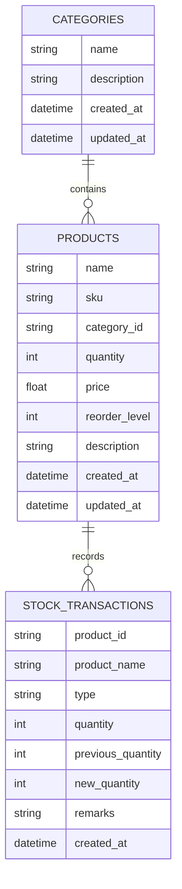

# StockFlow – Rosé Vanity

## Beauty Inventory Management System

**Timeless Beauty. Effortless Elegance.**

StockFlow – Rosé Vanity is a web-based Beauty Inventory Management System developed using Python Flask and Firebase Cloud Firestore. It provides a centralized platform for managing beauty products, organizing categories, monitoring stock movements, and generating inventory reports.

The system features an elegant, responsive interface with burgundy, rose wine, champagne, black plum, and ivory colors.

---

## Live Website

Access the StockFlow – Rosé Vanity website through the following link:

**Website URL:**  
https://stockflow2026-nine.vercel.app/

**Firebase Connection Health Check:**  
https://stockflow2026-nine.vercel.app/api/health

The application is hosted on Vercel, allowing users to access the website through an internet-connected device, subject to deployment availability.

---

## System Objectives

- Provide centralized management of beauty product inventory.
- Simplify product and category management.
- Monitor incoming and outgoing stock.
- Identify low-stock and out-of-stock products.
- Maintain accurate inventory transaction records.
- Generate inventory reports efficiently.
- Store and retrieve data using Firebase Cloud Firestore.
- Provide a responsive and user-friendly inventory management platform.

---

## System Features

### 1. Dashboard

- Total products
- Total categories
- Total stock units
- Total inventory value
- Low-stock products
- Total stock transactions
- Animated inventory movement charts
- Product category distribution
- Stock-level monitoring

### 2. Product Management

- Add new products
- View product details
- Update existing products
- Delete eligible products
- Search products
- Filter products by category
- Unique SKU validation
- Product card and table views
- Automatic stock-level indicators

### 3. Category Management

- Add product categories
- View category details
- Update existing categories
- Delete unused categories
- Search categories
- Display associated product counts

### 4. Stock In

- Record incoming inventory
- Select existing products
- Enter incoming quantities
- Automatically increase product stock
- Record transaction remarks
- Maintain stock movement history

### 5. Stock Out

- Record outgoing inventory
- Automatically decrease product stock
- Validate available quantities
- Prevent insufficient stock transactions
- Maintain outgoing transaction records

### 6. Transaction History

- View all inventory movements
- Filter Stock In and Stock Out records
- Search transaction records
- Display previous and updated stock quantities
- Display transaction dates and remarks
- Preserve transaction history as audit records

### 7. Reports

- Inventory summary
- Product stock reports
- Inventory valuation
- Low-stock monitoring
- CSV report export

### 8. User Interface

- Responsive website layout
- Collapsible sidebar navigation
- Dark and light mode
- Persistent theme preference
- Animated dashboard statistics
- Interactive charts
- Professional icons
- Gradient buttons
- CRUD modal forms
- Delete confirmation dialogs
- Toast notifications
- Search and filtering
- Pagination
- Firestore connection indicator
- Automatic connection checking

---

## Technologies Used

| Technology | Purpose |
|------------|---------|
| Python | Backend programming |
| Flask | Web application framework |
| Firebase Cloud Firestore | NoSQL cloud database |
| Firebase Admin SDK | Database integration |
| HTML5 | Website structure |
| CSS3 | Styling and responsive design |
| JavaScript | Frontend functionality |
| Chart.js | Dashboard charts |
| Lucide Icons | Interface icons |
| Google Fonts | Website typography |
| PyCharm | Development environment |
| GitHub | Source code repository |
| Vercel | Cloud deployment platform |

---

## Database Structure

The system uses three interconnected Firebase Cloud Firestore collections.

### 1. Products Collection

Collection Name: `products`

This collection stores beauty product information and inventory details.

| Field | Data Type | Description |
|-------|-----------|-------------|
| name | String | Product name |
| sku | String | Unique product identifier |
| category_id | String | Reference to product category |
| quantity | Integer | Available stock quantity |
| price | Number | Product unit price |
| reorder_level | Integer | Minimum stock threshold |
| description | String | Product description |
| created_at | Date/Time | Record creation date |
| updated_at | Date/Time | Last modification date |

### 2. Categories Collection

Collection Name: `categories`

This collection stores product classifications.

| Field | Data Type | Description |
|-------|-----------|-------------|
| name | String | Category name |
| description | String | Category description |
| created_at | Date/Time | Record creation date |
| updated_at | Date/Time | Last modification date |

### 3. Stock Transactions Collection

Collection Name: `stock_transactions`

This collection stores incoming and outgoing inventory records.

| Field | Data Type | Description |
|-------|-----------|-------------|
| product_id | String | Reference to product |
| product_name | String | Product name |
| type | String | Stock In or Stock Out |
| quantity | Integer | Transaction quantity |
| previous_quantity | Integer | Stock before transaction |
| new_quantity | Integer | Stock after transaction |
| remarks | String | Transaction remarks |
| created_at | Date/Time | Transaction date |

---

## Database Relationships

- One category can contain multiple products.
- Each product belongs to a category.
- One product can have multiple stock transactions.
- Each stock transaction references an existing product.
- Linked-record deletion protection maintains database integrity.

### Relationship Diagram



---

## CRUD Operations

| Module | Create | Read | Update | Delete |
|--------|--------|------|--------|--------|
| Products | Yes | Yes | Yes | Yes |
| Categories | Yes | Yes | Yes | Yes |
| Stock Transactions | Yes | Yes | No | No |

Stock transactions are intentionally preserved as immutable audit records to maintain accurate inventory history.

Products and categories with linked records are protected against deletion when necessary to maintain database integrity.

---

## Project Structure

```text
StockFlow/
│
├── app.py
├── main.py
├── firebase_config.py
├── check_firebase.py
├── seed_data.py
├── requirements.txt
├── vercel.json
├── README.md
├── .env
├── .env.example
├── .gitignore
├── Stockflow.json
│
├── templates/
│   └── index.html
│
└── static/
    ├── css/
    │   └── style.css
    │
    ├── js/
    │   └── app.js
    │
    └── images/
        └── model.jpg
```

Note: The `.env` and `Stockflow.json` files are private local configuration files and must not be uploaded to GitHub.

---

## System Requirements

- Python 3.10 or newer
- PyCharm or Visual Studio Code
- Firebase account
- Firebase Cloud Firestore database
- Firebase service account credentials
- Internet connection
- Modern web browser

---

## Installation and Setup

### Step 1: Download the Project

Clone or download the StockFlow repository from GitHub.

Open the project folder using PyCharm.

### Step 2: Create a Virtual Environment

Open the PyCharm terminal and execute:

```powershell
python -m venv .venv
```

Activate the virtual environment:

```powershell
.venv\Scripts\Activate.ps1
```

### Step 3: Install Dependencies

```powershell
python -m pip install -r requirements.txt
```

### Step 4: Configure Firebase

1. Open the Firebase Console.
2. Select or create a Firebase project.
3. Enable Cloud Firestore.
4. Open Project Settings.
5. Select Service Accounts.
6. Generate a new private key.
7. Rename the downloaded file to `Stockflow.json`.
8. Place the file inside the StockFlow project folder.

Never publicly upload or share the Firebase service account private key.

### Step 5: Configure Environment Variables

Create a `.env` file in the project root directory.

```env
GOOGLE_APPLICATION_CREDENTIALS=Stockflow.json
FLASK_DEBUG=false
PORT=5008
```

### Step 6: Test Firebase Connection

Run the Firebase connection checker:

```powershell
python check_firebase.py
```

### Step 7: Insert Sample Data

The project includes an optional seed script for inserting sample inventory records into Firebase Cloud Firestore.

```powershell
python seed_data.py
```

The sample data may include:

- Beauty product categories
- Sample beauty products
- Stock In transactions
- Stock Out transactions
- Product descriptions
- Product prices
- Inventory quantities

Check existing database records before running the seed script to avoid unwanted duplicate data.

### Step 8: Run the Application

```powershell
python app.py
```

Open the local development website:

http://127.0.0.1:5008/

The local development URL is only accessible from the computer running the Flask application by default.

---

## Website Access

### Online Website

The primary website URL for StockFlow – Rosé Vanity is:

[Open StockFlow – Rosé Vanity](https://stockflow2026-nine.vercel.app/)

### Local Development Website

[Open Local StockFlow Website](http://127.0.0.1:5008/)

The online website is hosted through Vercel. The local website is intended for development and testing purposes.

---

## Firebase Connection Status

The application provides a health-check API endpoint for verifying the Firebase Cloud Firestore connection.

### Online Health Check

https://stockflow2026-nine.vercel.app/api/health

### Local Health Check

http://127.0.0.1:5008/api/health

Example successful response:

```json
{
    "message": "Connected to Cloud Firestore",
    "success": true
}
```

The website checks the Firestore connection and updates the connection indicator based on the server response.

---

## API Endpoints

| Method | Endpoint | Description |
|--------|----------|-------------|
| GET | /api/health | Check Firebase connection |
| GET | /api/summary | Retrieve dashboard statistics |
| GET | /api/products | Retrieve all products |
| POST | /api/products | Create a product |
| GET | /api/products/{id} | View a product |
| PUT | /api/products/{id} | Update a product |
| DELETE | /api/products/{id} | Delete an eligible product |
| GET | /api/categories | Retrieve all categories |
| POST | /api/categories | Create a category |
| GET | /api/categories/{id} | View a category |
| PUT | /api/categories/{id} | Update a category |
| DELETE | /api/categories/{id} | Delete an unused category |
| GET | /api/stock_transactions | Retrieve stock transactions |
| GET | /api/stock-transactions | Retrieve stock transactions |
| GET | /api/stock_transactions/{id} | View transaction details |
| POST | /api/stock-transactions | Record stock movement |

---

## Data Validation

The system includes validation mechanisms to maintain accurate and consistent inventory records.

- Required field validation
- Unique product SKU validation
- Valid product price
- Non-negative stock quantity
- Non-negative reorder level
- Existing category references
- Existing product references
- Positive stock movement quantities
- Insufficient stock prevention
- Linked-record deletion protection
- Delete confirmation dialogs
- Error handling

Stock transactions cannot be edited or deleted through the application because they serve as inventory audit records.

---

## Website Design

StockFlow – Rosé Vanity features an elegant beauty-inspired interface designed to provide a professional and user-friendly inventory management experience.

### Design Theme

Rosé Vanity – Luxury Beauty Inventory

### Color Palette

| Color | Hex Code |
|-------|----------|
| Burgundy | #481426 |
| Black Plum | #21191F |
| Rose Wine | #843B53 |
| Champagne | #DFBF96 |
| Ivory | #F4EBE6 |

### Design Elements

- Elegant beauty photography
- Custom RV monogram
- Professional navigation sidebar
- Interactive dashboard cards
- Gradient buttons
- Colorful CRUD buttons
- Smooth hover animations
- Responsive layouts
- Dark and light mode
- Modern typography
- Interactive charts
- Animated statistics
- User-friendly modal forms

External photographs, fonts, icons, and chart libraries may require an internet connection.

Decorative product photographs are illustrative and do not necessarily represent actual inventory items.

---

## Vercel Deployment

StockFlow – Rosé Vanity is configured for cloud deployment using Vercel.

### Deployment Information

| Information | Details |
|-------------|---------|
| Project Name | StockFlow2026 |
| Hosting Platform | Vercel |
| Backend | Python Flask |
| Database | Firebase Cloud Firestore |
| Website URL | https://stockflow2026-nine.vercel.app/ |
| Repository Platform | GitHub |

### Deployment Procedure

1. Upload the project source code to GitHub.
2. Sign in to Vercel.
3. Select Add New Project.
4. Import the StockFlow GitHub repository.
5. Open the Environment Variables section.
6. Add the following environment variable:

```env
FIREBASE_SERVICE_ACCOUNT
```

7. Set its value to the complete contents of a valid Firebase service account JSON file.
8. Save the environment variable.
9. Deploy or redeploy the application.
10. Open the generated Vercel website URL.
11. Test the Firebase health-check endpoint.

The Firebase configuration must support reading service account credentials from the environment variable.

### Live Application

https://stockflow2026-nine.vercel.app/

---

## Security and Privacy

The following files must not be uploaded to GitHub:

- `.env`
- `Stockflow.json`
- Firebase service account private keys
- Virtual environment files
- Python cache files

Firebase credentials must be stored securely using local environment configuration or Vercel environment variables.

The current application is intended for academic demonstrations and controlled environments.

The system does not currently include user authentication or role-based access control. Public deployment should be protected with appropriate access controls before storing confidential or production inventory data.

---

## Troubleshooting

### Firestore Connection Failed

- Verify the Firebase service account filename.
- Check the `.env` configuration.
- Confirm that Cloud Firestore is enabled.
- Check the internet connection.
- Verify Firebase permissions.
- Restart the Flask application.
- Test the `/api/health` endpoint.

### Internal Server Error on Vercel

- Check the Vercel deployment logs.
- Verify the Firebase environment variable.
- Confirm that all required dependencies are included.
- Check the Firebase configuration file.
- Redeploy the application after making changes.

### Website Remains on Connecting

- Verify that `/api/health` returns a successful response.
- Check the browser console for JavaScript errors.
- Confirm that `static/js/app.js` is loaded.
- Press Ctrl + Shift + R to refresh cached resources.

### Unable to Load Records

- Check the Flask terminal or Vercel runtime logs.
- Verify the Firestore collection names.
- Confirm that Firebase credentials have database access.
- Check the API endpoints individually.

### Port Already in Use

StockFlow uses port 5008 for local development.

Stop any existing application using the same port before restarting Flask.

---

## Future Enhancements

- User authentication
- Role-based access control
- Barcode scanning
- QR code product identification
- Supplier management
- Purchase order management
- Product expiration monitoring
- Automatic low-stock notifications
- PDF report generation
- Sales monitoring
- Advanced inventory analytics
- Inventory forecasting

---

## Academic Purpose

This project was developed as a Final Practical Activity for Advanced Database Management.

It demonstrates the implementation of a cloud-based NoSQL database using Firebase Cloud Firestore, Python Flask, interconnected collections, CRUD operations, data validation, inventory management, responsive web development, and cloud deployment.

The project applies database management concepts through a practical beauty inventory management system.

---

## Project Information

| Information | Details |
|-------------|---------|
| Project Name | StockFlow – Rosé Vanity |
| System Type | Beauty Inventory Management System |
| Subject | Advanced Database Management |
| Database | Firebase Cloud Firestore |
| Backend | Python Flask |
| Frontend | HTML, CSS, and JavaScript |
| Development Environment | PyCharm |
| Hosting Platform | Vercel |
| Version Control | GitHub |
| Academic Year | 2026–2027 |
| Website | https://stockflow2026-nine.vercel.app/ |

---

# StockFlow – Rosé Vanity

### Timeless Beauty. Effortless Elegance.

A centralized, modern, and cloud-based beauty inventory management system.

**Visit Our Website:**

https://stockflow2026-nine.vercel.app/

Developed for educational and academic purposes.

© 2026 StockFlow – Rosé Vanity.
